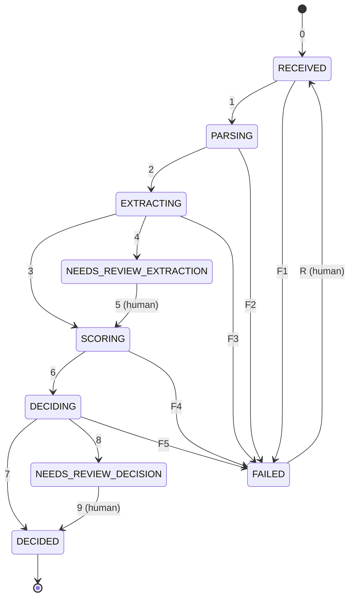

# TradeCredit AI: design doc

Living document. v1 due Week 3 (Gate 1).

## 1. Problem and users
## 2. Requirements
### Functional
### Non-functional (latency, throughput, availability, cost)
## 3. User flows
## 4. Architecture (C4: context, containers)
## 5. Data model and entities
## 6. Application state machine

An application is always in exactly one of nine states. Every move it's allowed to make is in one table,
`ALLOWED_TRANSITIONS` in `backend/app/domain/application.py`, and anything not in that table gets refused. Every move
also goes into an audit log with who did it, why, and when. Why it looks like this: [ADR-0001](adr/0001-application-state-machine.md).

### States

Each state is either waiting (parked, nobody's touching it) or working (a worker has it). They go wrong in different
ways. A waiting state goes wrong when nobody ever comes for it. A working state goes wrong when the worker drops it.

| State | Kind | Who has it | What's true |
|---|---|---|---|
| `RECEIVED` | waiting | nobody, it's in the queue | Pack saved, `202` and a job id sent back. Nothing has read the files yet |
| `PARSING` | working | worker | Turning the upload into clean text (PyMuPDF, no LLM) |
| `EXTRACTING` | working | worker, mostly waiting on Claude | Claude fills the extraction schema and Pydantic checks it |
| `NEEDS_REVIEW_EXTRACTION` | waiting | a reviewer | A field's quote wasn't found in the document |
| `SCORING` | working | worker | The scorecard runs. Plain Python decides, not the LLM |
| `DECIDING` | working | worker, waiting on Claude | Outcome plus a memo with citations |
| `NEEDS_REVIEW_DECISION` | waiting | a credit officer | The scorecard said Refer |
| `DECIDED` | finished | nobody | Fund, Decline, or the officer's call. Nothing moves after this |
| `FAILED` | waiting | a person (engineer or borrower) | Retries ran out, or the error won't go away by retrying |

### Moves and what triggers them

| # | Move | Trigger | Who |
|---|---|---|---|
| 0 | upload → `RECEIVED` | Pack saved, API sends back `202` and a job id | API |
| 1 | `RECEIVED → PARSING` | A worker picks up the job | worker |
| 2 | `PARSING → EXTRACTING` | Clean text saved | worker |
| 3 | `EXTRACTING → SCORING` | JSON passes validation and every field's quote is in the source | worker |
| 4 | `EXTRACTING → NEEDS_REVIEW_EXTRACTION` | A field's quote isn't in the source (Claude may have made it up) | worker |
| 5 | `NEEDS_REVIEW_EXTRACTION → SCORING` | Reviewer accepts or corrects the field | person |
| 6 | `SCORING → DECIDING` | Scorecard result saved | worker |
| 7 | `DECIDING → DECIDED` | Outcome is Fund or Decline, memo saved | worker |
| 8 | `DECIDING → NEEDS_REVIEW_DECISION` | Outcome is Refer | worker |
| 9 | `NEEDS_REVIEW_DECISION → DECIDED` | Credit officer makes the call | person |
| F1 | `RECEIVED → FAILED` | The sweeper has put it back in the queue 3 times and it's still stuck | sweeper |
| F2 to F5 | `PARSING`, `EXTRACTING`, `SCORING`, `DECIDING` → `FAILED` | Retries ran out, or the error is permanent | worker |
| R | `FAILED → RECEIVED` | An engineer retries after a fix, or the borrower re-uploads | person |

### How it behaves

- Retries happen inside a working state. They aren't moves. If something might work a few seconds later (a timeout, a
  `429`, broken JSON), the worker waits a bit longer each time and tries again, and the state stays the same. `FAILED`
  means we've stopped trying and a person has to do something, so the borrower never sees "failed" flash up and then
  disappear during a retry.
- Some errors go away if you try again and some never will. When we don't know which one we've got, we treat it as the
  first kind for a capped number of retries, then give up. `SCORING` doesn't retry at all: it's deterministic, so the
  same input crashes the same way every time.
- Every working state can go to `FAILED`. Without that exit, a crash would leave it looking busy forever.
- Waiting on a person is never a failure, so the review states can't go to `FAILED`. A late reviewer gets reminders and
  then escalation, because it can't just be left sitting there.
- A field that's valid but wrong isn't a failure either, and retries won't catch it. So every extracted field comes with
  the quote it came from, and code checks the quote is really in the document. If it isn't, the application goes to a
  reviewer before scoring. We don't score a number we don't trust.
- The table only says what's possible. When to move (how many retries, how many re-queues, how long a state can sit
  before it counts as stuck, when to remind a reviewer) is policy, and that lives in the worker and the sweeper.
- A sweeper looks for applications that have sat in one state too long. Parsing normally takes well under a second, so
  its limit can be short. That's how we notice a worker that died without saying anything.

### Open questions and known gaps

- Two workers moving the same application at the same time. The repository will handle that with a version number or
  a row lock.
- Loading the audit history back from the database. That's for the repository PR.
- Review load. If lots of fields get flagged, reviewers get swamped. I'll measure the straight-through processing rate
  in the Week 8 evals. If it's too low: one field per review card, flag only fields the scorecard uses, and improve the
  prompt using reviewers' corrections.

## 7. API contract (OpenAPI draft)
## 8. Sync vs async boundary
## 9. AI components (extraction, scoring, RAG, evals)
## 10. Risks and open questions
## 11. Changelog (what changed and why)

- **2026-11-05:** §6 written. 9 states, not 8: review split into `NEEDS_REVIEW_EXTRACTION` and
  `NEEDS_REVIEW_DECISION` so each review has one way in and one way out ([ADR-0001](adr/0001-application-state-machine.md)).
